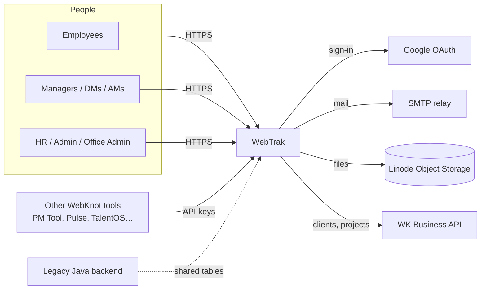
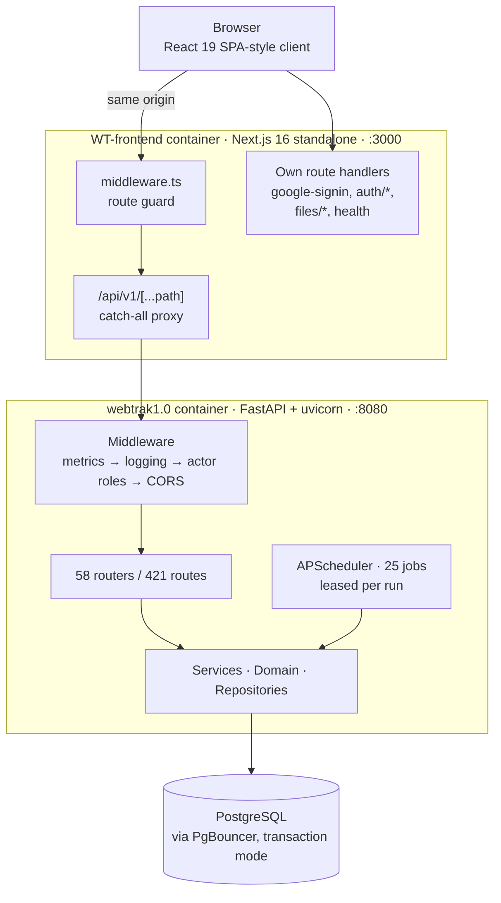
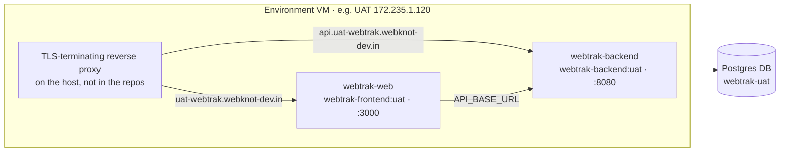
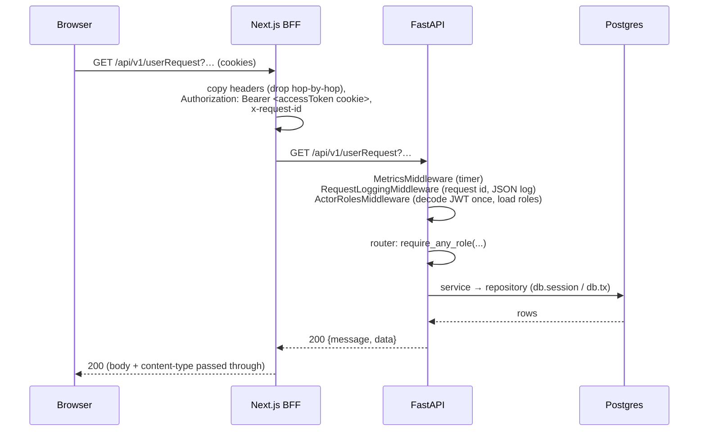
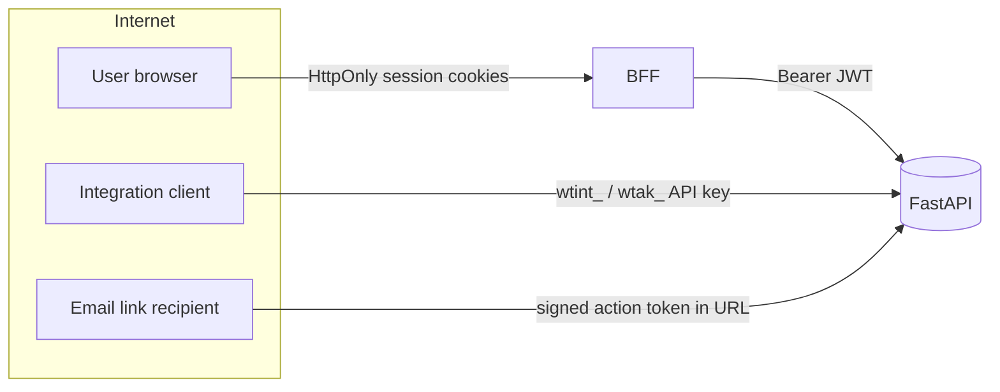

# 01 — System architecture

WebTrak is Webknot's internal HR and workforce platform. Employees use it for leave, work from home, comp-off,
timesheets, allocations, learning, Pulse reviews, chat and company information; managers approve and review; HR and
admins run onboarding, offboarding, masters, compliance and reports.

This document is the high-level design: what the parts are, where they run, how a request travels through them, where
the trust boundaries are, and which quality attributes drove the shape.

## 1. Context

| External system | Direction | Purpose | Failure behaviour |
| --- | --- | --- | --- |
| Google OAuth 2.0 | out | Only sign-in method | Sign-in impossible; existing sessions keep working until they expire |
| SMTP relay | out | Transactional and notification mail | Circuit breaker opens; actions still succeed, mail is logged as failed (doc 05) |
| Linode Object Storage | out | Profile photos, documents, policies, chat files, bug-report attachments, holiday spreadsheets | Circuit breaker; photos fall back to the database copy |
| WK Business API | out | Source of truth for clients and projects | Breaker opens and WebTrak serves the last synced local copy |
| Integration clients | in | Read-only machine access with `wtint_…` / `wtak_…` keys | Keys revoked from Admin → Apps & keys |
| Legacy Java backend | shared DB | Original system; some tables (`monthly_submissions`) keep its shapes | See doc 09, ADR-002 |

## 2. Containers

Two deployable units plus the database. The browser never talks to FastAPI directly: every call goes to the Next.js
app on the same origin, which proxies `/api/v1/*` to FastAPI (the backend-for-frontend, BFF).

| Container | Responsibility | Does **not** do |
| --- | --- | --- |
| Frontend (Next.js) | Renders the UI; owns the OAuth callback and auth cookies; proxies every API call; serves a few runtime-config routes | Business rules, authorization decisions, database access |
| Backend (FastAPI) | All business rules, authorization, persistence, scheduled jobs, outbound integrations | Rendering, cookie management for the browser (it reads the cookie the BFF forwards) |
| PostgreSQL | System of record | — |

Why a BFF rather than calling FastAPI from the browser: the session cookies stay HttpOnly on one origin, there is no
CORS surface for the browser, and the frontend can add request ids and translate auth for every call in one place.
The cost is one extra hop per request and a second place a header can be lost (see doc 07, incident class "Lost in
the proxy"). ADR-001 in doc 09 records the decision.

## 3. Deployment topology

Each environment is one Linux VM running Docker Compose. Images are built **on the server** from the environment's
branch (there is no registry or CI yet).

| Environment | Branch | Frontend host | API host | Notes |
| --- | --- | --- | --- | --- |
| Local | any | `localhost:3000` | `localhost:8080` | `NEXT_PUBLIC_API_BASE_URL` may point the browser straight at FastAPI |
| Develop | `develop` | `webtrak.webknot-dev.in` | `webtrak-api.webknot-dev.in` | |
| UAT | `uat` | `uat-webtrak.webknot-dev.in` | `api.uat-webtrak.webknot-dev.in` | Compose file and deploy script live only on the server: `/root/docker-compose.yml`, `/root/uat_script.sh` |
| Production | `prod` | `webtrak.webknot.in` | — | Observability overlay in `observability/` (`bbdecaf`) |

**Build-time vs run-time configuration** is the single most important deployment fact on the frontend. Next.js inlines
every literal `process.env.NEXT_PUBLIC_*` into the bundle at `next build`, **including in server route handlers**.
A value set on a running container is therefore invisible unless the code reads it through a computed name
(`process.env[name]`, as `src/lib/linodeObjectStorage.ts` does). The Relay assistant hit this in November 2026
(commit `0ace51e`, doc 07 INC-05); doc 06 §5 explains the rule.

The backend reads its configuration at start-up from `webtrak1.0/.env` on the server (`env_file:` in compose).
Changing it needs `docker compose up -d webtrak-backend` (recreate), not `restart`.

## 4. Request lifecycle

A normal signed-in API call, end to end:

Notes that matter in practice:

- **401 vs 403.** No valid session is always **401**; a wrong role is **403**. The frontend refreshes the token
  only on 401. Returning 403 for "no session" once caused refresh storms (doc 07).
- **Silent refresh is single-flight.** Concurrent 401s share one refresh promise (`refreshInFlight` in
  `src/lib/auth.ts`). A network blip during refresh does not sign the user out (`fix(auth)` in doc 07).
- **Request ids** are generated by the BFF, accepted by the backend (`accept_request_id`), and printed in every log
  line and returned to the browser. Bug reports capture the last request ids, so a user report maps to server logs.
- **Slow work never sits in the request.** Email and push notifications are sent after the response
  (`spawn_background_task`, doc 02 §6). Submitting leave used to wait on SMTP (`a6f002a`); bug reports used to time
  out after 30 s while emailing every HR person (`67cf1e9`).

## 5. Trust boundaries and authentication paths

| Caller | Credential | Checked by | Scope |
| --- | --- | --- | --- |
| Signed-in user | JWT access token (30 min, HS256) + per-device refresh token (7 days, rotated) | `require_any_role`, `get_actor_email` in `app/api/access.py` | The user's roles, re-read from the database per request |
| Integration client | API key (`wtint_…` read-only integrations, `wtak_…` app keys) | `app/api/integration_auth.py`, `app/api/api_key.py` | Key's own scope; revocable |
| Email quick-action link | HMAC token naming request + approver, 7-day expiry | `app/core/action_tokens.py` | Only previews; deciding needs a deliberate POST, and the decision goes through the normal approval rules |

**Every route authenticates or is explicitly public.** Authorization is called inside handlers, so forgetting it would
silently open a route. `tests/test_route_auth_coverage.py` walks every registered route and fails unless the handler
reaches a guard, or the route is listed in `PUBLIC_ROUTES` with a reason. ADR-006 records why this is a test rather
than a framework default.

## 6. Data architecture (summary)

Everything hangs off `users`. Doc 03 and doc 04 have the detailed models for time off and allocations.

- **Ledgers, not counters, for money-like quantities.** Leave balances are a monthly snapshot (`leave_mappings`) plus an
  append-only movement log (`leave_transactions`: ACCRUAL, RESERVE, DEDUCT…). Comp-off is a set of grants with expiry.
  This is what made "where did my balance go" questions answerable during the leave incidents of October 2026.
- **Status strings validated in `app/domain/*`**, not database enums, because several tables are shared with the
  legacy Java backend.
- **Audit by construction.** Approval decisions write `user_request_tracking` rows; the request row alone never tells
  the whole story.
- **Time.** Timestamps are stored in UTC; the business zone is `APP_TIMEZONE` (Asia/Kolkata). "Today", month
  boundaries and scheduler hours are IST. The API exchanges `dd/mm/yyyy` dates.

## 7. Quality attributes and how they are met

| Attribute | Target / concern | Mechanism | Where |
| --- | --- | --- | --- |
| Correctness under concurrency | Two approvals or an approval racing the accrual job must not lose leave | Transaction-scoped advisory locks per person; row-level checks inside the lock | doc 02 §3, `app/core/locks.py` |
| No duplicate background work | Several replicas each run the scheduler | Row lease per job run (`scheduler_job_leases`) | doc 02 §4, `app/core/job_lease.py` |
| Bounded latency | A stuck lock or slow statement must not hang a request | Per-transaction `lock_timeout`, `statement_timeout`, `idle_in_transaction_session_timeout` | doc 02 §2, `app/core/database.py` |
| Resilience to dependencies | SMTP / storage / WK Business outages must not break core flows | Circuit breakers; side effects after commit; stale-data fallback | doc 02 §5–6, doc 05 |
| Security | Least privilege, no open routes, no secrets in the browser | Server-side role checks, route-auth coverage test, signed tokens, fail-closed config | doc 02 §7–9 |
| Observability | Any user report traceable to logs | JSON logs with request id, Prometheus metrics, OTel traces, browser telemetry intake | doc 05 §6, `docs/OBSERVABILITY.md` |
| Operability | Safe, repeatable deploys across three branches | Branch flow develop → uat → prod; migrations on start under an advisory lock | doc 08 |
| Usability on every device | Phone, tablet, desktop | Responsive shell, phone drawer, touch-sized rows | doc 06 |

## 8. Known architectural risks

| Risk | Why it matters | Mitigation in place | Next step |
| --- | --- | --- | --- |
| No CI | Type errors and failing tests are found during the server-side Docker build | Guard tests exist and pass locally | Run `pytest`, `tsc`, `eslint`, `pnpm build` on every push |
| Environments configured by hand on each VM | Drift between UAT and prod; secrets only on the box | Doc 08 lists every variable | Keep compose + env templates in a repo; use a secret store |
| Shared tables with the legacy Java app | Schema or JSON-shape changes can break it | Shapes kept compatible; doc 09 ADR-002 | Retire Java writers per module, then normalise |
| One uvicorn process per backend (default) | It saturates one CPU core between 100 and 150 active users (doc 10) | `UVICORN_WORKERS` + `uvicorn[standard]`; 4 workers kept p95 at 27 ms with 200 active users | Set `UVICORN_WORKERS` per environment after checking the DB connection budget (doc 10 §6b) |
| Single VM per environment | No redundancy | Job leases already make multiple replicas safe | Add a second app instance behind the proxy |
