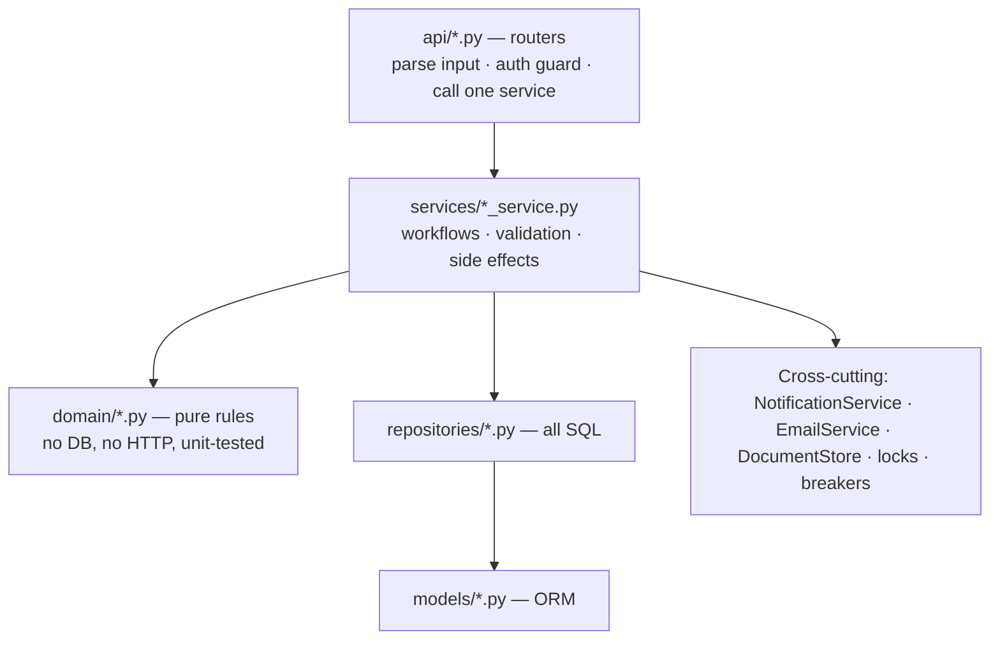

# 02 — Backend low-level design

The backend is a layered FastAPI application. This document lists the recurring patterns a change is expected to
reuse, with the file that implements each and the production problem that made it necessary (see doc 07).

## 1. Layering



| Layer | Rule | Example |
| --- | --- | --- |
| Router | No business logic. Call `require_any_role(...)` / `get_actor_email(...)`, then one service method; return `GenericResponse{message, data}` | `app/api/compliance.py` |
| Service | Owns the workflow and raises `HTTPException` with a stable, user-readable `detail` | `UserRequestService.update_status` |
| Domain | Pure functions and constants: policies you want to test exhaustively | `leave_accrual_policy.py`, `request_reversal.py`, `session_policy.py` |
| Repository | All queries. Methods accept an optional `client=` session so several calls join one transaction | `AllocationRepository.get_active_non_bench_for_user(user_id, client=None)` |
| Schema | Pydantic DTOs on `ApiModel`; dates serialise as `dd/mm/yyyy` | `app/schemas/*` |

**Why a separate domain layer:** the rules that cost the most in production (leave accrual, year-end settlement, request
reversal windows, half-day conflicts) are exactly the ones that need table-driven tests. Keeping them free of I/O makes
a 20-case test a few lines.

## 2. Unit of work and bounded transactions

`app/core/database.py` exposes one `Database` singleton:

- `db.session()` — plain session for reads.
- `db.tx()` — a transaction (`session.begin()`) that first runs
  `set_config('lock_timeout' | 'statement_timeout' | 'idle_in_transaction_session_timeout', …, true)`.

Every write path runs inside `db.tx()` and passes the session down as `client=` to repositories, so the whole
operation commits or rolls back together. The three timeouts mean a request can never wait forever behind a lock or a
runaway query; it fails fast and the error handler turns the Postgres code into a retryable **503 "busy, try again"**
(`_busy_response` in `app/core/http_errors.py`). Introduced in the production-hardening commit `002c94d`.

Connections are pinned to UTC and the prepared-statement cache is disabled because production goes through PgBouncer in
transaction mode.

## 3. Advisory locks for multi-row read-modify-write

`SELECT … FOR UPDATE` protects one known row. A leave balance spread over monthly rows, a check-then-insert overlap
check, or a capacity sum across allocations needs one lock for the **whole sequence**. `app/core/locks.py`:

```python
await advisory_xact_lock(tx, LEAVE_BALANCE, user_id)   # pg_advisory_xact_lock(hashtextextended('leave-balance:42', 0))
```

| Property | Why it matters |
| --- | --- |
| Keyed by namespace + id | Only operations on the same person queue; everyone else runs in parallel |
| Transaction-scoped | Released at COMMIT/ROLLBACK, so an exception can never leak it; safe behind PgBouncer |
| Bounded by `lock_timeout` | A waiter fails fast instead of hanging |
| Namespaces in one module | `LEAVE_BALANCE`, `COMP_OFF_CREDIT`, `USER_REQUESTS`, `ALLOCATION_CAPACITY` — two features never share a key by accident |

**Rule:** take the lock *before* reading the data you will change. The monthly accrual job takes `LEAVE_BALANCE` per
person too, so an approval landing mid-accrual queues behind it instead of interleaving.

## 4. Run-once scheduled jobs (leases)

Every app instance runs APScheduler, so every job fires on every replica at the same moment. Before a job body runs it
claims its row in `scheduler_job_leases` (`app/core/job_lease.py`):

```sql
INSERT INTO scheduler_job_leases (job_id, holder, claimed_at) VALUES (:job_id, :holder, now())
ON CONFLICT (job_id) DO UPDATE SET holder = EXCLUDED.holder, claimed_at = EXCLUDED.claimed_at
 WHERE scheduler_job_leases.claimed_at < now() - make_interval(secs => :lease)
RETURNING holder
```

Losers get no row back and skip that run. A table rather than a session advisory lock because PgBouncer transaction
pooling would silently lose a session lock; a lease window rather than "one run per minute" because it needs no
knowledge of the trigger and absorbs clock skew. Every job therefore needs a stable `id=`.

**Idempotency inside jobs** is a second line of defence: the accrual job skips anyone who already has an ACCRUAL ledger
row for that month, because the job rebuilds the month's row from last month's balance and a re-run would otherwise
erase leave deducted since.

## 5. Circuit breakers for outbound dependencies

`app/core/circuit_breaker.py`: one named singleton breaker per dependency (`get_breaker("smtp")`,
`"wk_business_api"`, object storage). CLOSED → OPEN after `fail_max` consecutive failures → rejects for
`reset_timeout` seconds → one HALF_OPEN probe → CLOSED on success. State changes are Prometheus metrics and span events.

Paired with a fallback per dependency: WK Business serves the last synced local projects (`fix: serve stale local
projects on any WK Business failure`); profile photos fall back to the database copy; email failures are logged and
never roll back the business action.

## 6. Side effects after commit (fire-and-forget, safely)

Email and live notifications must never (a) block the response or (b) be published for data that then rolls back.

1. The service writes the business rows **and** the notification rows in the same `db.tx()`.
2. After commit it publishes the persisted rows to the SSE stream and schedules companion emails with
   `spawn_background_task(...)` (`app/utils/background_tasks.py`).
3. `spawn_background_task` keeps a strong reference to the task until it finishes and logs its exception. Bare
   `asyncio.create_task` can be garbage-collected mid-flight, which is how SMTP sends once silently vanished while the
   faster in-app publish appeared to work.

Incidents behind this: comp-off manager notifications published before commit (`Fix comp-off usage manager
notifications by publishing after request commit`), bug reports timing out at 36 s while emailing every HR user
(`67cf1e9`), leave submit waiting on SMTP (`a6f002a`).

## 7. Signed, expiring tokens (no database row)

`app/core/action_tokens.py` signs `{purpose, ids…, exp}` with HMAC-SHA256 using a key derived from the JWT secret plus a
purpose string. Used for email "Review & decide" links (`quick_action_service`). Rules learnt the hard way:

- A token **identifies**; it never acts on GET. The link opens a confirm page and the decision is a deliberate POST,
  so mail scanners that pre-fetch links can't approve anything.
- The decision still runs through `UserRequestService.update_status` as that approver with their real roles, so every
  approval rule applies.
- **A link that acts as someone is a credential: send it only to that person.** The leave email used to CC the
  requester on the manager's link, which let employees approve their own leave (`6fd45f8`, doc 07 INC-01).

The Relay tools service (Nov 2026, since removed — doc 05 §5) used the same idea in reverse: `app/domain/relay_signature.py` verified
`X-Relay-Signature-V2` (code in git history at `676693d`) over `relay-v2 \n timestamp \n operation \n session \n user \n body`, where `operation` is built
from **our** route (so a captured call to one tool can't be replayed against another), with a 5-minute freshness window
and constant-time comparison.

## 8. Fail closed when configuration is missing

A feature whose security depends on a secret refuses to run without it, rather than running open:

| Feature | Missing setting | Behaviour |
| --- | --- | --- |
| Production start-up | `JWT_SECRET=replace_me` | Process refuses to start |
| Dev login bypass | `APP_ENV=prod` without `ENABLE_OAUTH_BYPASS` + bootstrap key | Route blocked |

The opposite failure — "configured wrongly, fails silently" — is the most common class in doc 07, so new features
should also *log a warning* when a setting makes them a no-op (the SMTP "not configured" and "non-prod redirect" warnings
are the template).

## 9. Guard tests: turn silent mistakes into test failures

| Test | Catches |
| --- | --- |
| `tests/test_route_auth_coverage.py` | A new route that never reaches an auth guard (walks every route's call graph; public routes must be listed with a reason) |
| Email CTA guard (`56c49f2`) | Notification email buttons pointing at frontend pages that don't exist |
| Release-notes guard (frontend `scripts/tests`) | Malformed or oversized "What's new" entries |
| `scripts/e2e_*_check.py` | Real-Postgres checks for flows mocks can't prove (sessions per device, year-end reset, carry-forward, utilisation) |

## 10. Rate limiting human-triggered email

`app/services/email_rate_limit.py`: an in-memory limiter keyed by action + recipient, with a cooldown between sends and
a daily cap (`HR_EMAIL_COOLDOWN_MINUTES`, `HR_EMAIL_DAILY_CAP`). HR resend buttons (exit survey, onboarding invite)
return **429** with `Retry-After` when hit. Compliance reminders use a stronger, persistent rule instead: at most one
reminder per person per 24 h, checked against the notifications table so it survives restarts.

## 11. Errors

- Services raise `HTTPException(status, detail)` with a sentence a user can act on.
- `validation_exception_handler` turns Pydantic errors into one readable message per field.
- `database_exception_handler` maps Postgres SQLSTATEs: lock/statement timeouts → 503 retry; integrity errors → 409/400.
- `unhandled_exception_handler` returns JSON with the request id and logs the stack. The UI never sees a bare 500.

## 12. Checklist for a new backend feature

1. Router calls an auth guard (or is added to `PUBLIC_ROUTES` with a reason).
2. Writes in one `db.tx()`; multi-row balances/capacity under the right advisory lock, taken before reading.
3. Pure rules in `app/domain/` with table-driven tests.
4. Notifications written in the transaction, published and emailed after commit via `spawn_background_task`.
5. Outbound calls behind a named circuit breaker with a fallback.
6. Lists paginate on the server **and** the client reads every page it needs (doc 07 INC-12).
7. Scheduled job has a stable `id=` and is idempotent per period.
8. Secrets fail closed; no-op configuration logs a warning.
