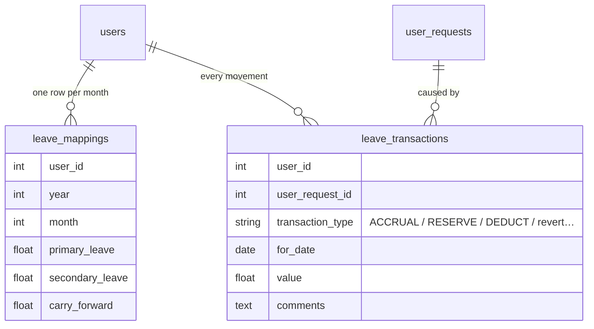
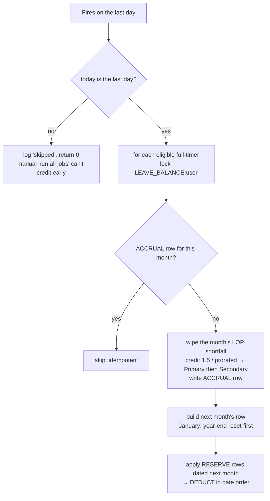
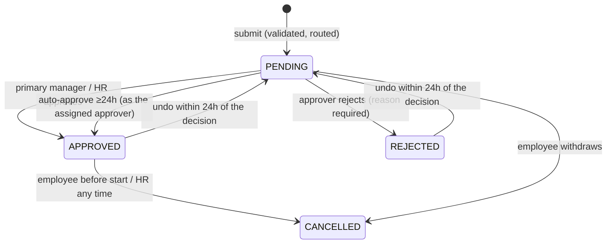
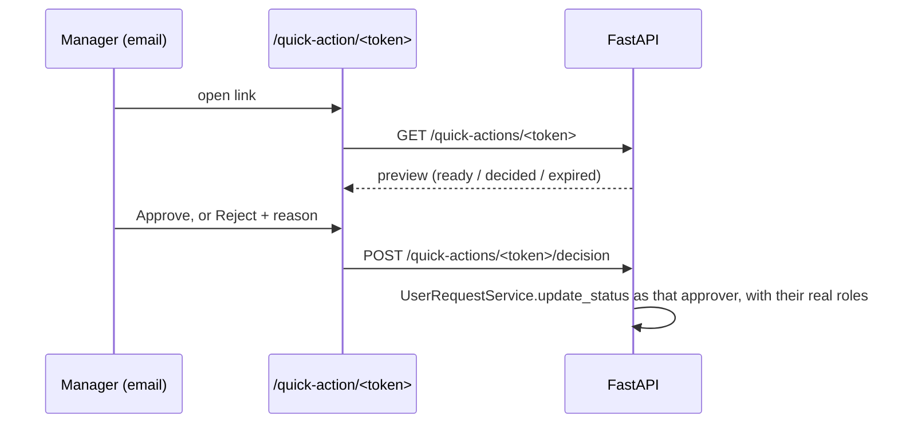

# 03 — Time off: leave, WFH and comp-off

Time off is the most used and most incident-prone part of WebTrak: money-like balances, several approvers, dates in
the future, holidays per person, and jobs that change balances while people are using them. This document describes
the model, the rules and the production issues that shaped each part.

## 1. Request types

| Type | Meaning | Consumes balance | Half day | Notes |
| --- | --- | --- | --- | --- |
| `LEAVE` | Paid leave | Primary first, then Secondary; shortfall is LOP | Yes (one day only) | |
| `OPTIONAL` | One of the optional holidays | Optional-holiday quota | No | Pairs with alternatives (`optional_leave_pair`) |
| `WFH` | Regular work from home | No | Yes | At most one regular WFH day per ISO week |
| `WFH_EXCEPTION` | Extra WFH beyond the weekly limit | No | Yes | Explicit exception request |
| `COMP_OFF_EARN` | Worked a holiday/weekend; asks for a credit | Creates a grant | — | Grant valid **60 days** (`CompOffService.VALIDITY_DAYS`) |
| `COMP_OFF` | Use comp-off credit | Comp-off grants, earliest expiry first | No | Routed to the employee's current project manager |

`LEAVE`/`OPTIONAL` are "leave-like", `WFH`/`WFH_EXCEPTION` are "WFH-like" (`_LEAVE_LIKE_TYPES`, `_WFH_LIKE_TYPES` in
`UserRequestService`). The request reason is limited to **1,000 characters**, one constant shared by backend
(`app/domain/request_limits.py`) and frontend (`src/constants/requestReason.ts`). It was 200, then 500. Each change
came from a user who couldn't explain a longer leave.

## 2. The leave ledger

- **`leave_mappings`** is the *balance snapshot* for each person per month: what they can use that month.
- **`leave_transactions`** is the append-only *movement log*. Every credit, reservation, deduction and reversal is a
  row, with the request that caused it.

Why both: the snapshot makes "what can I take now" a single read. The log makes "why is my balance this number"
answerable, and makes reversals exact (a reversal undoes the recorded rows, not a recomputation). The October 2026 leave
incidents (doc 07 INC-11, INC-13, INC-19) were each diagnosed by reading the ledger.

Every change to a person's balance runs inside `db.tx()` under `advisory_xact_lock(tx, LEAVE_BALANCE, user_id)`, taken
before reading. Approvals and the month-end job therefore never interleave (doc 02 §3).

## 3. Accrual and year-end policy

Pure rules in `app/domain/leave_accrual_policy.py`; constants mirror Employee Handbook S.4.1.

| Rule | Value |
| --- | --- |
| Annual entitlement | 18 days: 11 Primary + 7 Secondary |
| Monthly credit | 1.5 days, credited on the **last day** of the month it is earned (since `43c6985`, 26 Oct 2026) |
| Order | Primary until its 11 days are credited, then Secondary |
| Who accrues | Active and serving-notice **full-time** employees; consultants and interns don't |
| Joining month | Prorated by days worked: ≥10 → 0.5, ≥20 → 1.0, whole month (30, or 28 in Feb) → 1.5 |
| Exit month | Prorated by last working day (`exit_month_accrual`) |
| Usage order | Primary first, Secondary only when Primary is used up |
| Year end (1 Jan) | Unused Primary carries forward as Secondary, up to 7; the Primary days **above 7** are encashed, at most 4; Secondary never carries |

### History of the joining-month and encashment rules

These rules changed three times, and the changes are recorded here because each one moved real balances:

1. **Until 19 Oct 2026:** joining month prorated by joining day (1.5 / 1.0 / 0.5 / 0). Onboarding someone *before*
   their joining month credited that month at onboarding **and** again in the month job: a 1 Nov joiner ended November
   with 3.0 (doc 07 INC-11). Fixed in `6c0cd4b` (credited once), with `scripts/report_double_joining_credit.py` to list
   people affected earlier.
2. **19 Oct 2026 (`6bc817e`):** every joiner gets a full 1.5. Year-end encashment switched to the handbook's written
   rule ("only the days above 7"), because the handbook's own example 2 contradicted it.
3. **26 Oct 2026 (`43c6985`):** credit moved to the last day of the month, and the joining month prorated by days
   *worked* (above). This is the current rule. Leave is therefore only ever taken against credits from earlier months.

Follow-up fixes on the month-end change: `0e6cbb4` (a month already credited on the 1st under the old rule counts as
credited, so it can't be credited again and the year summary doesn't inflate carry-forward) and the fix that builds
next month's row even when the month was already credited.

## 4. The month-end job

`ScheduledJobsService.add_monthly_leaves_and_carry_forward`, scheduled `monthly_leave_rollup` at **23:50 IST on the
last day** of each month:

The job claims its scheduler lease first (doc 02 §4), so only one replica runs it. The per-person ACCRUAL check means a
second run that day changes nothing. That protection exists because an earlier version rebuilt the month from last
month's balance on every run and erased leave deducted since (doc 07 INC-13).

## 5. Applying leave: reserve, deduct, LOP

- **Leave in a month whose balance row exists** → deducted now: Primary, then Secondary; anything short is **LOP**
  for this request only. The LOP flag and alert reflect the current deduction, not history.
- **Leave in a future month** → a **RESERVE** row, not taken from today's balance (`aa05f77`). The month-end job turns
  reservations into DEDUCT rows once that month's balance exists (`app/services/leave_reserved_service.py`).
  Before this, approving December leave in October reduced October's usable balance (doc 07 INC-19).
- **Leave for a month with no balance row** no longer counts as LOP by default (a missing row is "not yet built", not
  "empty").
- Holidays and weekends inside a leave range are not leave days. Holidays come from **each person's** holiday calendar
  (`ab3186a`).
- The **leave-impact preview** (`GET /profile/balances/leave-impact`) runs the same split before submit, so the form
  says "covered" or "N days LOP" up front.

## 6. Request lifecycle

Every transition writes a `user_request_tracking` row (actor, action, previous and new status), and the response
carries approval history plus who is still pending, so "who approved this" is never a guess.

### 6.1 Validation on submit

- Dates in range; half day only for a single day.
- Leave balance check per month (Primary + Secondary + future reservations).
- **Same-day conflicts.** Leave-like, WFH-like and comp-off usage are mutually exclusive on a day, with one exception:
  **two halves make one day** — a half-day leave may share its date with exactly one half-day WFH (or the reverse), never with a full
  day and never a third half (`9cdad4f`, bug #11 raised by an employee who worked from home in the morning and took the
  afternoon off). Later extended so an **emergency** half-day leave can be taken on a day already booked as WFH, full or
  half (`180037b`). The reverse direction and full-day clashes stay blocked.
- Regular WFH: one day, at most one per ISO week; more needs `WFH_EXCEPTION`.
- Comp-off can't be used on the day it was earned.

### 6.2 Routing: who approves

- The employee picks **primary managers** (must approve) and optional **secondary managers** (informed, may act).
  A manager can't be both. Picks are validated: active, has an approver role.
- Silent drops are rejected loudly. A comp-off manager without an approver role used to be dropped from routing while
  their email stayed on the row, so the request looked assigned and nobody could act (doc 07 INC-03). Now it's a 400.
- Comp-off usage reaches the employee's **current** project manager even when the requested day falls after the
  allocation ends (`787f054`).
- Talent-pool (unallocated) employees route to HR, not to a project manager.

### 6.3 Notifications and email

- Approvers get an in-app notification and an email. Emails greet approvers by name (`bfb1ae5`).
- **Each primary manager gets their own email carrying a signed "Review & decide" link, never CC'd.** Everyone else
  (requester, secondary managers, the two HR mailboxes) gets one informational copy with the plain WebTrak link.
  Before `6fd45f8` the manager's link was in a mail CC'd to the requester, who could approve their own leave
  (doc 07 INC-01).
- Delivery happens after the response (`a6f002a`), so submit no longer waits on SMTP.

### 6.4 Email quick actions

The token is HMAC-signed `{purpose, request id, approver id, exp}`, 7-day expiry, no database row
(`app/core/action_tokens.py`). GET only previews, so mail scanners that pre-fetch links cannot decide anything.

### 6.5 Auto-approval

Two jobs, deliberately different:

| Job | When | What it does |
| --- | --- | --- |
| `leave_auto_approve_daily` | Day of the leave | Records `APPROVED_BY_DEFAULT` tracking if no manager acted; the notification follows the request type (`3a4342f`) |
| `leave_wfh_auto_approve_24h` | Every 30 min, Mon–Fri | Approves requests still PENDING after 24 h by calling **`UserRequestService.update_status` as the assigned approver**, so balance deduction, tracking and notifications are identical to a manual approval. Each request is isolated; one failure never stops the batch |

Reusing the service rather than writing rows directly is the key design decision. An earlier auto-approval path only
wrote a tracking row and never deducted balance.

### 6.6 Undo and cancel (`app/domain/request_reversal.py`)

- **Undo:** the deciding approver may take back an approval or rejection for **24 h**; the request returns to PENDING
  and the balance movement is reversed from the ledger.
- **Cancel:** the employee may cancel an approved request **until it starts**; afterwards only HR. Approved comp-off
  *earn* is reversible only while its credit is unspent.
- Both email the people involved (`ae5a1da`).

## 7. Comp-off

- `COMP_OFF_EARN` approval creates a **grant** with a 60-day expiry.
- `COMP_OFF` usage consumes grants earliest-expiry first, under `COMP_OFF_CREDIT` advisory lock.
- `comp_off_*` reminders warn before expiry; expired grants notify (`COMP_OFF_EXPIRED`).
- The balance card counts usable units correctly. It used to understate them and block valid submissions (frontend fix).

## 8. Reports

| Report | Audience | Source |
| --- | --- | --- |
| Monthly LOP summary (`monthly_lop_summary_to_hr`, 1st 08:30) and month-end LOP report | HR | `lop_report_service.py` |
| Yearly leave report (xlsx) | HR/Admin | `leave_year_report_service.py` (`75625a7`) |
| Year summary on Home/Leave: Opening (carried forward) + Accrued − Taken = Balance | Employee | `leave_balance.py`; carried-forward read from last December's closing balance, taken also counts approved requests when the ledger is incomplete (`9482a0c`) |

## 9. Production issues in this area (summary)

| Issue | Doc 07 | Fix |
| --- | --- | --- |
| Employee could approve own leave via CC'd manager link | INC-01 | `6fd45f8` |
| Comp-off requests routed to someone who couldn't act | INC-03 | explicit 400 |
| Concurrent approvals produced wrong balances | INC-10 | advisory locks + bounded waits (`002c94d`) |
| Joining month credited twice | INC-11 | `6c0cd4b` |
| Accrual re-run erased the month's leave | INC-13 | per-month ACCRUAL idempotency |
| Mandatory holiday counted as leave day | INC-17 | per-calendar exclusion |
| Optional holiday imported as mandatory | INC-18 | parser + re-import script |
| Future leave reduced today's balance | INC-19 | RESERVE → DEDUCT |
| Leave/WFH submit slow | INC-21 | after-response delivery |
| Half-day leave blocked on half-day WFH day | INC-28 | `9cdad4f`, `180037b` |
| Policy disputes over joining month / encashment | INC-29 | §3 history |
| Approved leave didn't reduce the balance shown | — | balance read from the snapshot the deduction writes |
