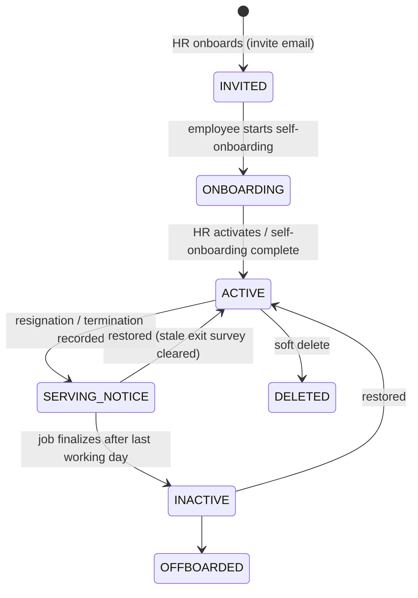
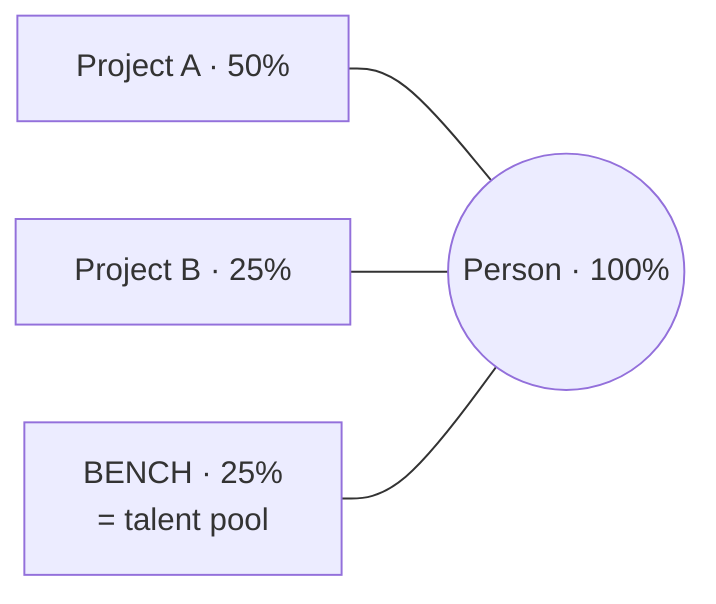

# 04 — Workforce: people, allocations and compliance

## 1. The employee lifecycle

| Concept | Values | Where |
| --- | --- | --- |
| Status | INVITED, ONBOARDING, ACTIVE, SERVING_NOTICE, INACTIVE, OFFBOARDED, DELETED | `app/domain/employee_status.py` |
| Who can sign in | Everyone except INACTIVE, OFFBOARDED, DELETED (`can_login`) | same |
| User type | FULLTIME, INTERN, CONSULTANT | `app/domain/work_profile.py` |
| Category | DELIVERY, NON_DELIVERY | same |
| Portal roles | EMPLOYEE (everyone), MANAGER, DM, AM, HR, ADMIN, FINANCE, OFFICE_ADMIN | `user_roles` table |

**Rules that came from production:**

- **Serving notice still allocatable and still able to use assigned trainings**, but cannot self-enrol in new ones.
  Serving-notice employees used to drop out of the allocation picker and the talent pool's unallocated list.
- **Future-dated user-type transitions** (Intern → Full-time, etc.) are stored and applied by
  `user_type_transitions_apply_daily`. Band and designation must be valid for the *new* type. Intern bands are
  rejected for full-timers, consultants have no band.
- **Notice period jobs:** `finalize_serving_notice_after_lwd_daily` deactivates after the last working day;
  `revert_premature_inactive_before_lwd_daily` repairs anyone made inactive too early. The last working day is counted
  inside the notice period (an earlier bug excluded it).
- **Restoring someone** from Inactive or Serving Notice clears their stale exit survey.
- **Technical vs non-technical** decides whether primary/secondary skills are required. Classified from department and
  designation keywords. "Finance Analyst" and HR analysts used to be wrongly forced to enter tech skills.
- **Departments and designations.** Canonical departments live in `app/domain/onboard_options.py` (Pre-Sales added
  Oct 2026). HR can add a new designation for a band + department straight from the onboarding form. Consultants pick
  from existing ones, because they have no band to attach a new one to. Designation id sequences are resynced after
  bulk loads (doc 07 INC-14).
- **Sessions per device.** Signing in or out on one device no longer ends the others (`8e09b68`).

## 2. Allocations and capacity

### 2.1 Model

An allocation puts a person on a project for a date range with **hours per day** (`allocated_hours`, max 8). The UI
works in percent: `percent = hours × 100 / 8` (`app/domain/allocation_percentages.py`; standard choices 50/100, extended
25/50/75/100).

| Field | Values | Meaning |
| --- | --- | --- |
| `allocation_type` | DEPLOYABLE, LOCKED, NONBILLABLE (NB), NONDEPLOYABLE, STAFFING, OFFBOARDED | LOCKED needs a locked-in date inside the window; STAFFING only on Staffing projects |
| `billing_status` | BILLED, BUFFER, INVESTMENT, TALENT_POOL | **NB has no billing status** — saving an NB allocation clears it (`dafa32e`) |
| `end_date` | date or null | Null = open-ended. Optional for NB only; required by the UI for every other type |

### 2.2 The talent pool is free capacity

A person's unallocated capacity is held as an allocation on the system project **BENCH**. Deallocating or ending a
project allocation returns its share to BENCH automatically. Rows with billing status `TALENT_POOL` on a real project
are also treated as talent pool for routing and reporting (`is_talent_pool_billing_sql` in
`app/domain/billing_status.py`). `GLOBAL` is a second system project used for role scoping; it never appears in lists.

### 2.3 Rules enforced on save

- Allocation window inside the project's start/end; an open-ended allocation only has its start checked.
- Start not before the employee's date of joining; the employee must be eligible (active or serving notice).
- **Daily cap:** the new hours plus overlapping non-bench allocations must not exceed 8 h for any day in the range
  (`assert_new_allocation_fits_daily_cap`), checked under the `ALLOCATION_CAPACITY` advisory lock.
- A project manager can't be assigned on BENCH or GLOBAL.

### 2.4 Lists: current vs history

The HR allocation page has a project-grouped list and a "People allocations" list (filters: end date, status, type,
project, client). Since Oct 2026 both have **Current / History**:

| View | Shows |
| --- | --- |
| Current | Live client-project allocations **plus each person's current BENCH row, labelled "Talent pool"**. Talent-pool rows are read-only with an **Allocate** button (they're system-managed capacity; editing them by hand would corrupt it) |
| History | Deallocated or superseded, inactive, past end date, type OFFBOARDED, or held by someone OFFBOARDED / INACTIVE / DELETED |

Rules in `isHistoryAllocationRow` / `isListedAllocationRow` (`WT-frontend/src/utils/allocationList.ts`). The backend
adds `employee_status` to every allocation row so the client can tell who has left (`d0b47be`).

**Production issue:** the list API returns at most 200 rows per call, oldest first, and the page read only the first
call, so with more than 200 allocations the **newest were silently missing** (doc 07 INC-12). The service now reads
every page for both active and deallocated lists (`fetchEveryPage` in `hrms.service.ts`).

### 2.5 Jobs and requests

| Job / flow | Behaviour |
| --- | --- |
| `deallocate_daily` (00:00) | Ends allocations past their end date; freed share returns to BENCH |
| `allocation_ending_reminder_daily` | Warns managers before an allocation ends |
| `reconcile_stale_manager_roles_daily` | Removes manager roles that no longer match any project |
| Extension requests | Managers ask to extend; HR/Admin approves (`allocation_extension_request`) |
| WK Business sync | Projects and clients come from WK Business; on any failure the last local copy is served |

## 3. Compliance nudges

HR's Compliance page flags gaps in active employees' records before they surface at offboarding
(`app/services/compliance_service.py`, `docs/COMPLIANCE_NUDGES.md`):

| Category | Flags |
| --- | --- |
| Missing documents | Aadhaar, PAN card, profile photo |
| Missing personal info | Date of birth, personal email |
| Exit survey pending | Serving notice, last working day within 14 days, survey not submitted (eligibility from `ExitInterviewService`) |

Built on a feature branch (`feat/compliance-remind`, Nov 2026) and not yet merged: an "All flags" view (one row per
person), department per row, CSV export (formula-safe cells), and **Remind**. Remind sends an in-app message + email at
most once per person per 24 h (checked against the notifications table), and routes pending exit surveys through the
existing exit-survey reminder with its own rate limit.

## 4. Profile photos and documents

Profile photos were on the container disk and **disappeared on every deploy** (doc 07 INC-27). They moved to the
database, then to S3-compatible object storage with the database as fallback and automatic move-over
(`a503f24`). Documents, policies, learning files, onboarding documents and referral resumes follow the same store with
an access-checked download endpoint. Old `local://` uploads tell the user to upload again instead of showing a dead
link.

## 5. Production issues in this area

| Issue | Doc 07 | Fix |
| --- | --- | --- |
| Newest allocations missing from lists | INC-12 | read every page |
| Role creation PK collisions after imports | INC-14 | sequence resync + retry |
| Allocation list/forecast 500s on date binds | INC-15 | aware-UTC normalisation |
| Profile photos lost on deploy | INC-27 | DB, then object storage |
| Offboarded people and talent pool in allocation lists | INC-30 | Current/History, talent-pool rows |
| Serving-notice employees missing from pickers | — | eligibility includes SERVING_NOTICE |
| WK Business changes never reached WebTrak | INC-06 | sync fix + breaker + stale fallback |
