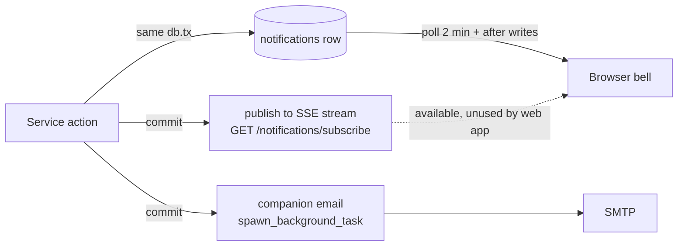
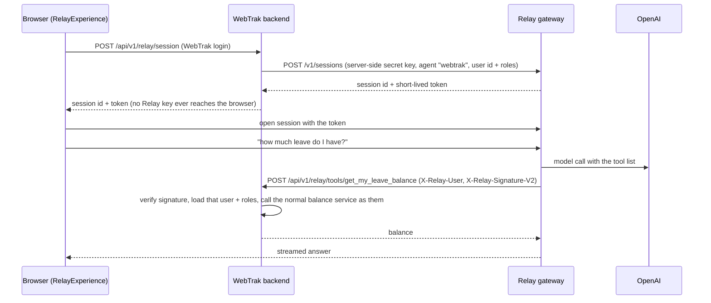

# 05 — Integrations and background work

Everything that happens outside a request/response: notifications and email, scheduled jobs, external systems,
observability, and the retired Relay assistant.

## 1. Notifications

- `NotificationService.send_notifications(receiver_ids, type, title, message, action_url, client=tx)` writes rows in the
  caller's transaction. With `client=None` it also publishes and emails; with a transaction, the caller publishes after
  commit (`_publish_persisted_notifications`). That ordering is what stopped notifications for requests that then
  rolled back (comp-off fix "publishing after request commit").
- **Delivery to the browser.** The backend offers a Server-Sent Events stream (`GET /notifications/subscribe`,
  `app/api/notification.py`), but the web app does not consume it today: the shell (`DashboardChrome.tsx`) loads the
  latest 50 on mount, polls every 2 minutes, and reloads 300 ms after any successful write on this device
  (`wt:data-changed`, shared across tabs via `localStorage`, `src/lib/dataRefresh.ts`). Sidebar badges and pending
  approvals poll every 30 s. The structural reason: the BFF proxy reads the whole upstream body (`upstream.arrayBuffer()`
  in `src/lib/serverApi.ts`) before replying, so a never-ending SSE response cannot pass through it as written. The
  cost is up to 2 minutes of latency for notifications caused by someone else. Streaming would need a dedicated
  pass-through route in the BFF.
- **Companion email** goes only to types in `_COMPANION_EMAIL_TYPES`, only if the user has email notifications on.
  Workflows with their own rich mail (leave, WFH, comp-off, onboarding) are excluded, so nobody gets duplicates.
- Every notification type has a frontend route (`src/utils/notificationNavigation.ts`) and an email CTA URL
  (`get_cta_url_for_notification`). The CTA map pointed several types at pages that didn't exist until `56c49f2`; a
  guard test now lists the real pages (doc 07 INC-31).
- `notification_cleanup_daily` removes old rows.

## 2. Email

| Concern | Design |
| --- | --- |
| Transport | SMTP via `EmailService`, run in a thread, behind circuit breaker `smtp` (opens after repeated failures) |
| Branding | `render_branded_email` wraps the body with the WebTrak header; the logo is embedded inline (`cid:webtrak-logo@webtrak`) so it shows even when remote images are blocked |
| Primary action | Optional CTA button (`cta_url`, `cta_label`) |
| From / Reply-To | Mail on behalf of a person uses their name as From display and their address as Reply-To; the envelope sender stays the system address |
| Non-prod safety | Outside `APP_ENV=prod`, every recipient is replaced by the dev inboxes while `SMTP_REDIRECT_NON_PROD=true` (UAT has it off, deliberately). Each redirected or dropped mail logs a WARNING |
| Rate limits | HR-triggered resends: cooldown + daily cap per recipient → 429 with `Retry-After` |
| Failure | Logged with the request id; never rolls back the business action |
| Timing | Always after the response for user-facing flows (doc 07 INC-20, INC-21) |

**Production issue (INC-02):** UAT employees never received mail. The dispatch code was correct; the non-prod redirect
silently sent everything to two dev inboxes. Diagnosis tip from this: when "no email arrives" in a non-prod
environment, check `APP_ENV` and `SMTP_REDIRECT_NON_PROD` before the code.

**Production issue (INC-01):** a signed approval link travelled in an email CC'd to the requester. Rule: an email that
carries a credential has exactly one recipient.

## 3. Scheduler

APScheduler runs inside the backend process (`app/jobs/scheduler.py`), with business-time triggers (IST). Every job:

1. has a stable `id=`;
2. claims its lease in `scheduler_job_leases` before running (doc 02 §4), so several replicas run it once;
3. logs `[scheduler] job=<id> STARTING` → `COMPLETED … result=…` or `FAILED`;
4. has a 1-hour misfire grace;
5. is idempotent for its period;
6. can be triggered manually (`app/api/scheduler.py`, `app/api/jobs.py`).

| Job id | Schedule (IST) | Purpose |
| --- | --- | --- |
| `timelog_defaults_every_3_days` | every 3 days (interval) | Timesheet reminders. An interval, because `CronTrigger(day="*/3")` means "day-of-month divisible by 3" and resets each month |
| `internship_completion_daily` | 00:00 | Internship end handling |
| `user_type_transitions_apply_daily` | 00:05 | Apply future-dated Intern/Consultant/Full-time changes |
| `finalize_serving_notice_after_lwd_daily` | 00:10 | Deactivate after last working day |
| `revert_premature_inactive_before_lwd_daily` | 00:12 | Repair people deactivated too early |
| `deallocate_daily` | 00:00:12 | End expired allocations; capacity back to BENCH |
| `reconcile_stale_manager_roles_daily` | 00:00:18 | Remove manager roles no project needs |
| `purge_old_chat_messages_daily` | 01:15:30 | Chat retention (1 year) |
| `purge_old_analytics_page_views_daily` | 01:20:45 | Telemetry retention |
| `notification_cleanup_daily` | 01:30 | Old notifications |
| `monthly_leave_rollup` | 23:50 on the last day of the month | Month-end leave credit (doc 03 §4) |
| `monthly_lop_summary_to_hr` | 08:30 on the 1st | LOP summary |
| `month_end_lop_report` | 18:30 Mon–Fri | Month-end LOP report |
| `leave_reminder_daily` | 11:30 | Pending leave reminders to approvers |
| `leave_auto_approve_daily` | 12:00 | Day-of default approval tracking |
| `leave_wfh_auto_approve_24h` | :00 and :30, Mon–Fri | Approve leave/WFH pending ≥24 h, through the normal service |
| `timelog_auto_approve_24h` | every 30 min | Approve timesheets pending ≥24 h |
| `policy_mark_pending_hourly` | :15 every hour | Mark unsigned policies pending |
| `allocation_ending_reminder_daily` | 09:00 | Allocation ending soon |
| `birthday_wishes_daily` | 09:00 | Birthday wishes |
| `joining_day_welcome_daily` | 09:15 | Welcome + announcement on joining day |
| `skill_rating_reminder_monthly` | 09:30 on the 1st | Skill rating reminder |
| `training_deadline_reminder_daily` | 09:45 | Mandatory training deadlines |
| `exit_interview_reminder_daily` | 10:00 | Exit survey reminders |
| `referral_ats_scoring_worker` | every 20 s | Referral résumé scoring queue |

**Removed on 11 Nov 2026:** `monthly_timelog_report_mail` (10:00 on the last working day, a PDF per project manager,
`fbc8468`). The report is still sent on demand: export dialog, or Admin `POST /scheduler/timelog-reports/run` (dry
run by default). A test fails if the scheduler registers the job again.

**Design rule from production:** a job that changes balances or sends mail must reuse the service method a user action
uses, not write rows directly. The 24 h leave auto-approval goes through `UserRequestService.update_status` as the
assigned approver so it deducts, tracks and notifies exactly like a manual approval. The older day-of path only wrote a
tracking row and never deducted.

## 4. External systems

| System | Client | Resilience | Fallback |
| --- | --- | --- | --- |
| WK Business API (clients, projects) | `app/services/wk_business_*.py`, httpx | Breaker `wk_business_api` | Serve the last local copy |
| Linode Object Storage (S3 API) | `linode_object_storage_service.py`, `DocumentStore` | Breaker per store | Photos fall back to the database copy |
| Google OAuth | `auth_service.py` | — | Sign-in unavailable; refused sign-ins name the Google account and what to do |
| Integration clients (inbound) | `/api/v1/integrations/*`, API keys | Keys revocable; read-only | — |

## 5. Retired: the Relay assistant (Nov 2026)

**Status: removed from develop, uat and prod on 5 Nov 2026** (`665f8fa`/`af1b8c3`/`bf6b536` backend,
`d29c281` frontend). The design is recorded here because it was built, debugged on UAT and taken out deliberately, and
because the patterns it used are reusable if an assistant comes back. The full code is in git history at `676693d`
(backend) and `1f8c812` (frontend).

**What it was:** an LLM assistant in the app that answered from the signed-in user's own WebTrak data. Relay was an
external gateway that ran the agent (prompt + model) and called back into WebTrak for data.

| Decision | Reason |
| --- | --- |
| Sessions started by WebTrak's backend, not the browser | The browser never holds a Relay key; the session carries the user id WebTrak authenticated |
| Tools are a WebTrak HTTP service, not direct DB access by the agent | Tools run through the same services as the pages, as that user with their roles, so the assistant sees exactly what the person can see |
| 9 read-only tools (`get_me`, `get_my_leave_balance`, `list_my_requests`, `list_requests_waiting_for_me`, `list_my_allocations`, `list_holidays`, `whos_out`, `list_announcements`, `list_my_trainings`) | No write path for a model to misuse; approver-only tools refused other roles with an explainable error |
| HMAC signature over timestamp, operation, session, user and body; operation built from **our** route; 5-minute window | A captured call can't be replayed later or against another tool |
| Result redaction (links, ids, tokens) and a ~5,500-character cap | Keep credentials and noise out of the model context |
| Fail closed: no signing secret → every tool call 503; no gateway/key → "not configured" | Missing configuration must never mean "open" |

**Production history on UAT:**

1. *Assistant "unavailable" although its env vars were set.* Next.js had inlined `NEXT_PUBLIC_*` into the config route
   at build time (INC-05). Fixed with run-time env lookup (`0ace51e`). The lesson outlived the feature (doc 06 §5).
2. *"this project has no agent 'webtrak'".* The Relay project had no agent, no model key and no tools service. Built
   the tools service, server-started sessions and the agent manifest (`676693d`, `1f8c812`).
3. *503 from `/relay/session` after deploy.* The values had been set on the frontend container instead of the backend,
   and a paste had duplicated a placeholder block in the backend `.env`. Cleaned up with a backup, recreated the
   container, and verified with a signed call to the public URL (signed → 200 with 9 tools, unsigned → 401) (INC-26).
4. *The gateway ran on a free ngrok tunnel* that went offline with its host machine — an operational dependency nobody
   owned.

**Why it was removed:** the call was made on 5 Nov 2026; the commits record the removal, not the reason. The open risk
in point 4 (a gateway with no permanent hosting) and a new external dependency holding user data are the design-side
arguments against keeping it until it can be hosted and owned properly.

**If it comes back:** host the gateway permanently, keep sessions server-started, keep tools read-only and routed through
services, keep the signature check and fail-closed config, and add the tools route to the route-auth guard test.

## 6. Observability

| Signal | Where |
| --- | --- |
| Structured JSON logs with `request_id` (from the BFF's `x-request-id`) | `app/middleware/request_logging.py`, `app/core/log_context.py` |
| Prometheus metrics: HTTP, breaker state, business gauges | `/metrics`, `app/core/metrics.py`, `app/core/business_metrics.py` |
| Traces | OpenTelemetry → Tempo (`OTEL_ENABLED`) |
| Health | `/health`, `/livez`, `/readyz`, `/health/dependencies` |
| Browser telemetry | Intake endpoint; page views purged by `purge_old_analytics_page_views_daily` |
| Stack | `observability/` compose: Grafana, Prometheus, Tempo, Loki, Alertmanager, blackbox; prod overlay binds UIs to localhost (`016f1fc`) |
| User bug reports | In-app form captures time, browser, screen, last page visits and **last API calls with request ids**, so a report maps straight to server logs |

Details: `docs/OBSERVABILITY.md`.
