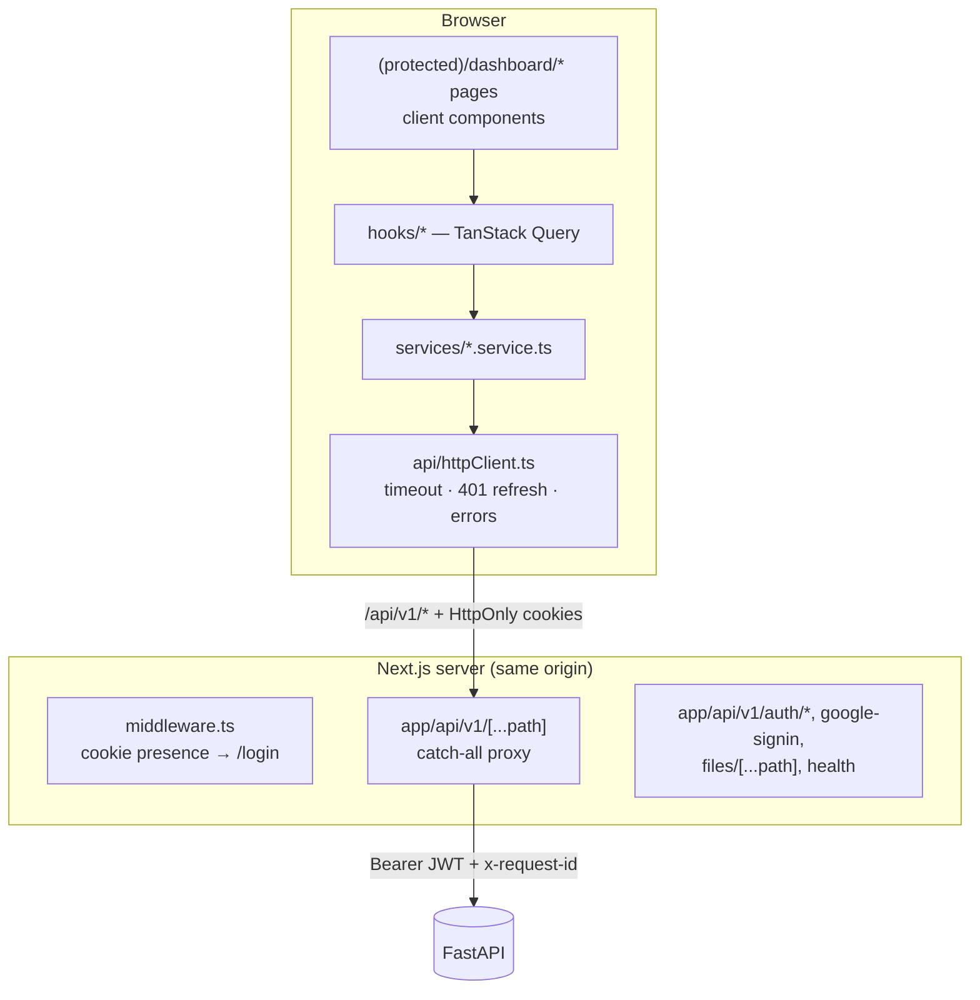
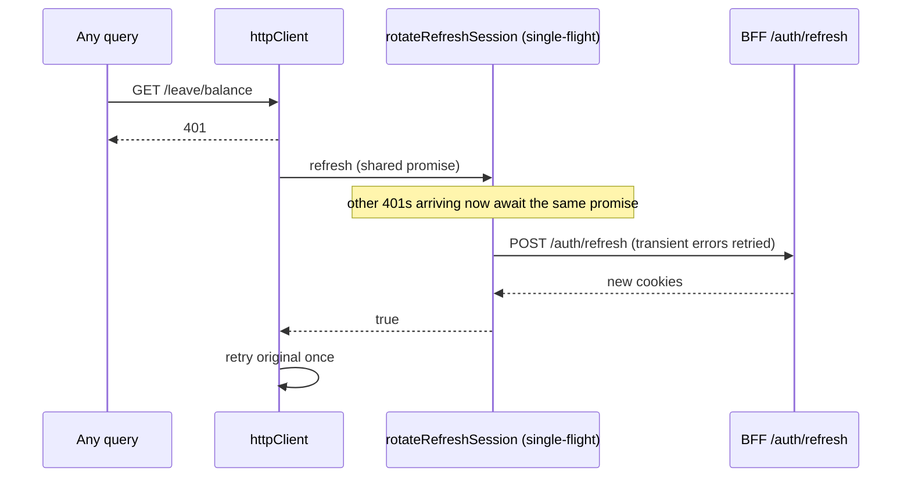

# 06 — Frontend low-level design

Repository: `WT-frontend` (Next.js 16.2, React 19.2, TanStack Query 5, Tailwind 4). Paths in this document are relative
to that repository.

## 1. Shape of the app

| Layer | Rule | Where |
| --- | --- | --- |
| Pages | `app/(protected)/dashboard/<module>/page.tsx` renders a `*PageClient` component; no fetching in the page file | 40+ modules under `dashboard/` |
| Hooks | One hook per server resource; query keys owned by the hook; mutations invalidate them | `src/hooks/<module>/*` (~100) |
| Services | Typed functions per backend area; URL building only via the endpoint registry | `src/services/*.service.ts` |
| Endpoint registry | Every backend path in one 480-line file; nothing else builds `/api/v1/...` strings | `src/api/endpoints.ts` |
| HTTP client | Timeout, auth, refresh, error parsing, request id capture | `src/api/httpClient.ts` |
| Pure helpers | Everything with a rule worth testing lives in `src/utils` / `src/lib` and is imported by `scripts/tests/*.test.mjs` | e.g. `utils/allocationList.ts` |

## 2. The BFF proxy

All browser API traffic goes to the same origin. `src/app/api/v1/[...path]/route.ts` hands every method to
`proxyUpstreamApiRequest` (`src/lib/serverApi.ts`):

1. **Refuse a misconfigured deployment.** In production, if `API_BASE_URL` (or its fallbacks) is empty or points at
   localhost, return 503 `backend_unconfigured` instead of silently proxying to nothing. This is the guard for
   doc 07 INC-24, where build-time rewrites baked `localhost` into the UAT image.
2. **Build upstream headers.** Drop hop-by-hop headers (`connection`, `keep-alive`, `te`, `transfer-encoding`,
   `upgrade`, `host`, `content-length`, `cookie`, `authorization`, …), forward the cookies, and set
   `Authorization: Bearer <accessToken cookie>`. The browser never sees the token: it is an HttpOnly cookie.
3. **One request id end to end.** Accept the caller's `x-request-id` if it matches `^[A-Za-z0-9_-]{8,64}$`, else mint
   one; send it upstream and echo it back. The backend logs it, the bug-report form captures it (doc 05 §6).
4. **Body as bytes.** Non-GET bodies are read as an `ArrayBuffer` so multipart uploads and JSON pass through unchanged,
   with `content-length` recomputed.
5. **Log only what matters.** One JSON line per upstream 5xx, unreachable backend, or response slower than 2 s
   (`logBff`), in the same shape as backend logs so one search covers both.
6. **Unreachable backend → 503 `backend_unavailable`**, never a hanging request.

Own route handlers exist only where the BFF must do something itself: Google sign-in start/callback (sets the `oauthState`
cookie, then the session cookies), `auth/*` (refresh, logout, cookie clearing), `files/[...path]` (object-storage
downloads), `health`.

**Known limitation:** the proxy buffers the whole response, so it cannot stream (SSE). Notifications are polled
instead (doc 05 §1).

## 3. Authentication on the client

| Rule | Why (production) |
| --- | --- |
| **Single-flight refresh.** `refreshInFlight` in `src/lib/auth.ts` holds one promise; every concurrent caller awaits it | Refresh tokens rotate. Two parallel refreshes spent the same token, the loser got 401 and cleared the cookies → random sign-outs (INC-09) |
| **Never refresh on 403.** 403 means "you lack the role", not "your session expired" | Refreshing on 403 raced with `AuthContext.refresh`, rotated twice and logged people out (comment in `httpClient.ts`) |
| **Transient ≠ refused.** Network errors and 5xx during refresh are retried with spacing; if still failing, the result is "unavailable" and the user stays signed in | Laptops waking from sleep, deploys and busy servers signed people out (`b053786`) |
| **An endpoint's own 401 is checked.** After a successful refresh, a second 401 asks `/auth/me` before signing out | One endpoint returning 401 for its own reason ended the whole session (`a406068`) |
| **Hard ends are believed.** Server says `idle` / `expired` / `inactive` → sign out with that reason shown on the login page | Users need to know *why* they were signed out |
| **Idle sign-out after 4 hours of inactivity in any tab** | Activity in one tab keeps every tab alive (`a8f2638`) |
| **Per-device sessions** on the backend | Signing in on a phone no longer ends the laptop session (INC-08, `8e09b68`) |

`middleware.ts` only checks that a session cookie *exists* and redirects to `/login?redirect=…` otherwise; it is a
navigation convenience, not a security boundary. Authorization is always the backend's (`require_any_role`), and the
backend ignores unsigned `email`/`roles` cookies.

## 4. Data layer

- **One `QueryClient` per signed-in tree** (`app/(protected)/layout.tsx`): `staleTime` 30 s, `gcTime` 10 min, refetch on
  focus and reconnect. Heavier or slow-changing data (self profile preferences) set longer `staleTime`.
- **Server state lives in TanStack Query; UI state stays in components.** Two contexts only: `AuthContext` and
  `UserPreferencesContext`.
- **Writes announce themselves.** `announceDataChange()` (`src/lib/dataRefresh.ts`) fires `wt:data-changed` and bumps a
  `localStorage` key, so badges, the notification bell and pending-approval counts in *every open tab* refresh after a
  write without each page knowing about the others.
- **Polling is deliberate and bounded:** sidebar badges and home approvals 30 s, notifications 2 min, chat thread on
  its own interval; `refetchIntervalInBackground: false` wherever a hidden tab shouldn't poll.
- **Read every page you need.** The backend caps list pages at 200. Screens that need "all" rows call
  `fetchEveryPage` (`services/hrms.service.ts`). Reading only page 0 is how the newest allocations went missing
  (INC-12).
- **Errors are sentences.** `parseApiErrorMessage` turns the backend's `detail` (string, field list, or object) into one
  readable message; components show it inline or as a toast. Network failure has its own message ("We couldn't reach the
  server just now…") instead of a generic error.
- **Timeouts:** default 30 s per request (`DEFAULT_REQUEST_TIMEOUT_MS`). The backend must answer within that, which is why
  emails moved after the response (INC-20).

## 5. Run-time configuration (the `NEXT_PUBLIC_*` rule)

`next build` replaces every literal `process.env.NEXT_PUBLIC_X` with its build-time value — **in server route handlers
too**. The Docker image is built once and configured on each VM, so a value set on the container is invisible to such
code. This broke the Relay assistant on UAT (INC-05, `0ace51e`) and is the same family as INC-24.

| Need | Do |
| --- | --- |
| Server-only setting (backend URL, storage keys, OAuth client) | Plain name without `NEXT_PUBLIC_`; read in a route handler or `src/lib/*` server module. `serverApi.ts` prefers `API_BASE_URL` |
| A server value read at request time | Look it up by a computed name (`process.env[name]`, as `src/lib/linodeObjectStorage.ts` does) so the bundler can't inline it |
| A value the browser needs | Serve it from a small server route at run time, not `NEXT_PUBLIC_*` |
| `NEXT_PUBLIC_*` | Only for values that are genuinely identical for every environment built from the image |

How to verify a config change: build once, then run the standalone server with the value set **only** at run time and
call the route.

## 6. Navigation model

`src/constants/dashboardNavigation.ts` is the single description of the sidebar: groups (`employee`, `projects`,
`personal`, `engage`, `more`), links and expandables, each with `roles`. `filterVisibleNavigation(items, roles, options)`
removes what the user can't use (HR access, account-manager access, exit-survey eligibility, and *everything* while
self-onboarding is incomplete). Page titles, breadcrumb section labels and the accordion state derive from the same
file, so a new page is added in one place.

Hiding a link is a UX decision, not access control; the page's API calls are still authorized by the backend. The
dashboard layout withholds children until the onboarding redirect decision is made: it used to render first and
redirect afterwards, so an invited/onboarding employee arriving from a bookmark or old email link could see and use a
full active-employee page until the redirect landed.

## 7. Design system

| Level | Where | Notes |
| --- | --- | --- |
| Tokens | `src/app/globals.css` (~227 custom properties) | Light and dark (`.dark` / `[data-theme="dark"]`); brand blue retained in the Oct 2026 refresh (`61a4692`) |
| Primitives | `src/components/ui/*` | button, input, select, combobox, date-picker, popover, tabs, table, checkbox, ConfirmDialog… |
| Product components | `src/components/dashboard/ui/*` | `PageHero`, `DataTable`, `PagedList`, `ListFilters`, `FilterDisclosure`, `EmptyState`, `SectionSkeleton`, `WtStatusBadge`, `FormSection`, `FormActionBar`, `LimitedTextarea` |

Conventions: every list has loading (skeleton), empty (`EmptyState` with the next action) and error states; status
uses `WtStatusBadge` tones, not ad-hoc colours; text limits are shown as you type (`LimitedTextarea`, matching
backend limits such as the 1,000-character leave reason).

**The October 2026 redesign** (`ca689b0`, release note `2026-10-22-01`) replaced the shell: a light sectioned sidebar
with counts, breadcrumb header with search, new sign-in, and a Home built around the day (approvals with inline approve,
leave, who's where, holidays, learning). A
requirement for every redesigned page: phone and tablet users must not lose anything, so each layout is checked at
phone, tablet and desktop widths.

## 8. "What's new" and guard tests

- `src/constants/releaseNotes.ts`: add an entry at the top with id `YYYY-MM-DD-NN` and deploy; each user sees it once.
  `scripts/tests/releaseNotes.test.mjs` fails on bad ids, wrong order, invalid dates, empty or wall-of-text highlights,
  and duplicates. Ids must only increase: reusing one would show it again to everyone who read it.
- Unit tests: `pnpm test:unit` runs 37 files in `scripts/tests` with Node's built-in runner and type stripping (no
  Jest). They cover the pure rules: allocation lists (`peopleAllocations`), leave ranges, who's out calendars, refresh
  policy, session activity, bug-report text, image cropping.
- There is **no CI**; a type error is found by `next build` on the server (INC-23). Before pushing, run
  `pnpm lint`, `pnpm test:unit` and `pnpm build` locally.

## 9. Diagnostics

- **Bug reports** capture context automatically (`src/lib/diagnostics/captureContext.ts`, `recorder.ts`): page, browser,
  screen size, recent page visits and recent API calls with their status and `x-request-id`.
- **Telemetry** (`src/lib/telemetry`): page views and Web Vitals, rated (`rating.ts`) and sent to the backend intake.

## 10. Checklist for a new frontend feature

1. Path added to `src/api/endpoints.ts`; service function typed.
2. Hook owns the query key; mutations invalidate it and call `announceDataChange()` if counts elsewhere change.
3. Lists that need everything use `fetchEveryPage`; paged lists use `ListPagination`.
4. Loading, empty and error states from the shared components.
5. Nav entry in `dashboardNavigation.ts` with `roles`; backend still authorizes.
6. No `NEXT_PUBLIC_*` for anything that differs per environment.
7. Pure logic in `src/utils` with a test in `scripts/tests`.
8. Release note if users will notice.
