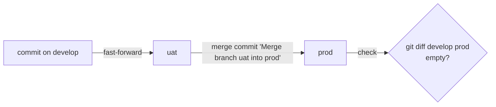

# 08 — Operations runbook

How changes reach users, how to change configuration safely, and what to do when something breaks. Every step here
exists because skipping it caused an incident in doc 07.

## 1. Environments

| Env | Branch (both repos) | Frontend | Backend | Notes |
| --- | --- | --- | --- | --- |
| Develop | `develop` | `webtrak.webknot-dev.in` | `webtrak-api.webknot-dev.in` | Integration of all work |
| UAT | `uat` | `uat-webtrak.webknot-dev.in` | `api.uat-webtrak.webknot-dev.in` | VM `172.235.1.120`, DB `webtrak-uat`. Compose file and deploy script live only on the server (`/root/docker-compose.yml`, `/root/uat_script.sh`) |
| Production | `prod` | `webtrak.webknot.in` | — | Live users. Pushing `prod` may deploy |

Each environment is one VM running `docker compose` (backend, frontend, PostgreSQL; production goes through PgBouncer). Images are built
**on the server** from the checked-out branch.

## 2. Branch flow: develop → uat → prod

Every change, fix or feature, goes to all three branches in both repos, in this order:



Without switching branches (the frontend repo usually has an unrelated dirty `.idea/workspace.xml` that blocks checkout):

```bash
git fetch origin
git push origin develop:develop develop:uat
git worktree add -B prod-promote ../prod-promote origin/prod
git -C ../prod-promote merge --no-ff develop -m "Merge branch 'uat' into prod"
git -C ../prod-promote diff develop HEAD --stat
git push origin prod-promote:prod
git worktree remove ../prod-promote && git branch -D prod-promote
```

Rules:

- **Fetch first and promote from `origin/*`, never from a stale local `prod`/`uat`.** A push from a stale local prod was
  rejected once (Oct 2026).
- `uat` must stay a fast-forward of `develop`. If it isn't, someone committed to uat directly: bring that commit back
  to develop first.
- After the merge, `git diff develop prod` must be empty. A non-empty diff means prod has something develop doesn't.
- Commit messages say *why* (the user-visible problem and the fix), because the history is the incident record.

> As of 11 Nov 2026 the backend's `origin` (`github.com/Vikas-WN/webtrak1.0`) answers "repository not found" from the
> development machine. Fix the remote or access before pushing; nothing reaches UAT/prod until then.

## 3. Before you push (there is no CI)

A type error or failing test is otherwise discovered by the Docker build on the server (INC-23, INC-25).

| Repo | Run |
| --- | --- |
| Backend | `pytest` (≈1,680 tests; `-m "not integration"` skips DB-backed ones); for DB-sensitive changes also the relevant `scripts/e2e_*_check.py` against a real Postgres |
| Frontend | `pnpm lint`, `pnpm test:unit`, `pnpm build` (the build is where `tsc` runs) |
| API renamed or a page's calls changed | k6 smoke profile (`loadtest/README.md`), so the load test keeps matching the app |

## 4. Deploying UAT

UAT is reachable only through an SSH ControlMaster socket the operator opens on their machine:

```bash
ssh -M -S ~/.ssh/cm-webtrak-uat -fN root@172.235.1.120
```

Tools and other people then reuse it non-interactively:

```bash
ssh -S ~/.ssh/cm-webtrak-uat -o BatchMode=yes root@172.235.1.120 '/root/uat_script.sh'
```

The root password is never pasted into chats, tickets or scripts; anyone who has seen it in one should treat it as
exposed and have it rotated. Prefer adding SSH keys for the people who deploy.

`/root/uat_script.sh` pulls the `uat` branches, rebuilds and restarts the containers, and writes
`/root/uat_deploy_<timestamp>.log`. Read the end of that log before declaring a deploy done.

## 5. Configuration changes

| Rule | Why |
| --- | --- |
| Backend config is `webtrak1.0/.env` on the server (`env_file:` in compose). After editing: `docker compose up -d webtrak-backend` (recreate). `docker compose restart` does **not** reload `env_file` | INC-26: new values ignored after a restart |
| Back up before editing: `cp .env /root/backups/webtrak1.0.env.bak_$(date +%Y%m%d_%H%M%S)` | A paste once duplicated a whole block with placeholder values; later lines win, silently |
| After editing, check for duplicate keys: `cut -d= -f1 .env \| grep -v '^#' \| sort \| uniq -d` must print nothing | Same incident |
| Inspect values masked, never print secrets: `sed -E 's/=(.{4}).*/=\1…/' .env` | Logs and chat transcripts are not secret stores |
| Server-side settings belong to the container that uses them. Backend secrets on the backend, not the frontend | INC-26 / Relay: values were set on the wrong container |
| Frontend: `NEXT_PUBLIC_*` is fixed at build time. Changing it needs a rebuild; anything per-environment must be read at run time | INC-05, INC-24, doc 06 §5 |
| Non-prod email: `APP_ENV != prod` + `SMTP_REDIRECT_NON_PROD=true` sends **all** mail to the redirect inboxes. UAT has it off on purpose so testers get real mail | INC-02 |
| `ENABLE_SCHEDULER=false` disables every job (logged at start-up). Leave it on in every real environment | Jobs are what credit leave and end allocations |
| `UVICORN_WORKERS` (default 1) sets backend processes. Raise to 2–4 only after checking `workers × (DB_POOL_SIZE + DB_MAX_OVERFLOW)` fits the database; then recreate the backend and check each scheduled job still runs once | One process saturates at ~90 req/s; 4 workers kept p95 at 27 ms with 200 active users (doc 10 §6b) |

## 6. Verifying a release

1. Deploy log ends cleanly; `docker compose ps` shows backend and frontend up.
2. `GET /readyz` and `/health/dependencies` on the backend are green.
3. Backend log shows migrations at head and `[scheduler]` jobs registered (or the expected "scheduler disabled").
4. Open the frontend through the **public URL** and sign in.
5. Exercise the change itself through the public URL, not just localhost on the box. For integrations, make a real
   signed/authorised call through the public URL and check one unsigned call is refused (that is how the Relay tools
   service was verified: signed → 200 with 9 tools, unsigned → 401).
6. For email changes: send one real mail to yourself and check sender, recipients, CC (no credential links CC'd,
   INC-01) and the button URL (no 404s, INC-31).
7. Add a "What's new" entry if users will notice (doc 06 §8).

## 7. Database operations

- **Migrations** run in `docker-entrypoint.sh` (`alembic upgrade head`) and again at app start-up; `alembic/env.py`
  takes a Postgres advisory lock so two starting containers serialize. Name new files `YYYYMMDD_NN_description.py`.
  Known issue: `upgrade head` on a completely empty database fails; restore a schema first.
- **Migrations must be backward compatible for one release** (add nullable column → backfill → enforce later). The
  legacy Java backend still reads some shared tables (ADR-002).
- **Before any bulk data change, take a dump**:
  `pg_dump -Fc -d webtrak-uat -f /root/backups/webtrak-uat_<what>_<timestamp>.dump`. The Sept 2026 UAT allocation and
  manager reloads were each preceded by one.
- **After bulk inserts with explicit ids, resync sequences** (`setval(pg_get_serial_sequence(...), max(id))`).
  Forgetting this caused primary-key collisions on the next normal insert (INC-14).
- **Data-repair scripts are reports first.** `scripts/report_double_joining_credit.py` lists affected people before
  anyone fixes balances (INC-11). New fix scripts should default to a dry run.
- Useful one-offs live in `scripts/`: `reimport_holiday_calendar.py` (INC-18), `move_profile_photos_to_object_storage.py`
  (INC-27), `resplit_leave_buckets.py`, `fold_carry_forward_into_secondary.py`, `fix_alembic_version.py`.

## 8. Incident response

Follow **symptom → evidence → root cause → fix → verification**. Don't change code until the evidence points somewhere.

1. **Pin the symptom:** who, which page, when, what they expected. A bug report from the app already carries the page,
   browser, recent API calls and their `x-request-id`s.
2. **Find the request:** search backend and BFF logs for the request id. Status, duration and the error are there.
3. **Check configuration before code** (classes A and F are mostly configuration): `APP_ENV`, SMTP redirect, missing
   or duplicated env keys, the wrong container, build-time inlining.
4. **Check data:** the actual rows (ledger, request, allocation) for that person, not what the UI shows.
5. **Reproduce with a test** that fails for the same reason, then fix.
6. **Ship through the full branch flow** (§2) and verify on the public URL (§6).
7. **Record it** in doc 07 with the class, root cause, fix commit and the guard that prevents a repeat. Reply to the
   reporter in plain words: what happened, what changed, and anything they need to do.

### Quick diagnosis table

| Symptom | First thing to check | Past incident |
| --- | --- | --- |
| "Nobody gets email" in non-prod | `APP_ENV`, `SMTP_REDIRECT_NON_PROD`, startup warnings | INC-02 |
| Some emails missing, in-app fine | Background task failures in logs; SMTP breaker state | INC-04 |
| Feature "not configured" though env is set | Which container has the value; recreate vs restart; `NEXT_PUBLIC_*` inlining | INC-05, INC-26 |
| BFF 503 `backend_unconfigured` / `backend_unavailable` | `API_BASE_URL` on the frontend container; backend up | INC-24 |
| Random sign-outs | 401 vs 403 contract; parallel refreshes | INC-09 |
| Balance looks wrong | Ledger rows for that person and month; whether the month job ran twice; joining-month rule | INC-10, 11, 13, 19 |
| "Newest records missing" | Pagination: is the client reading every page? | INC-12 |
| Dates off by a day / 500 on dates | Naive vs aware datetimes; `dd/mm/yyyy` contract | INC-15, 16 |
| 503 "busy, try again" | Lock/statement timeouts: who holds the lock, slow query | INC-10 |
| PK collision on insert | Sequence behind `max(id)` | INC-14 |
| Email button 404 | CTA map vs real routes | INC-31 |
